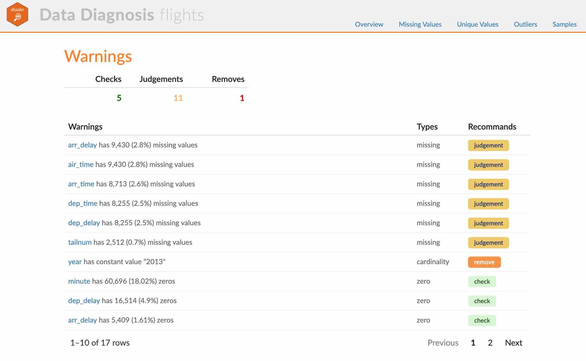
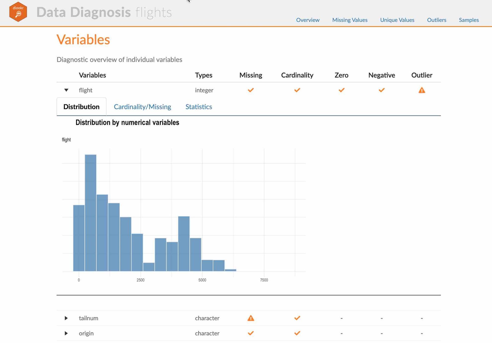
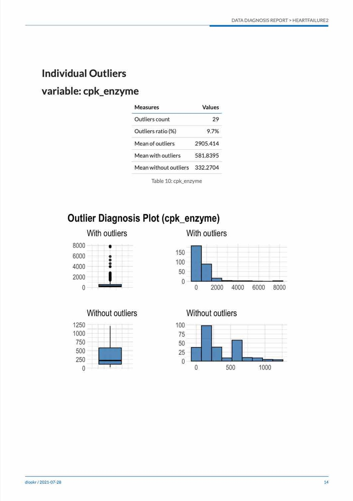
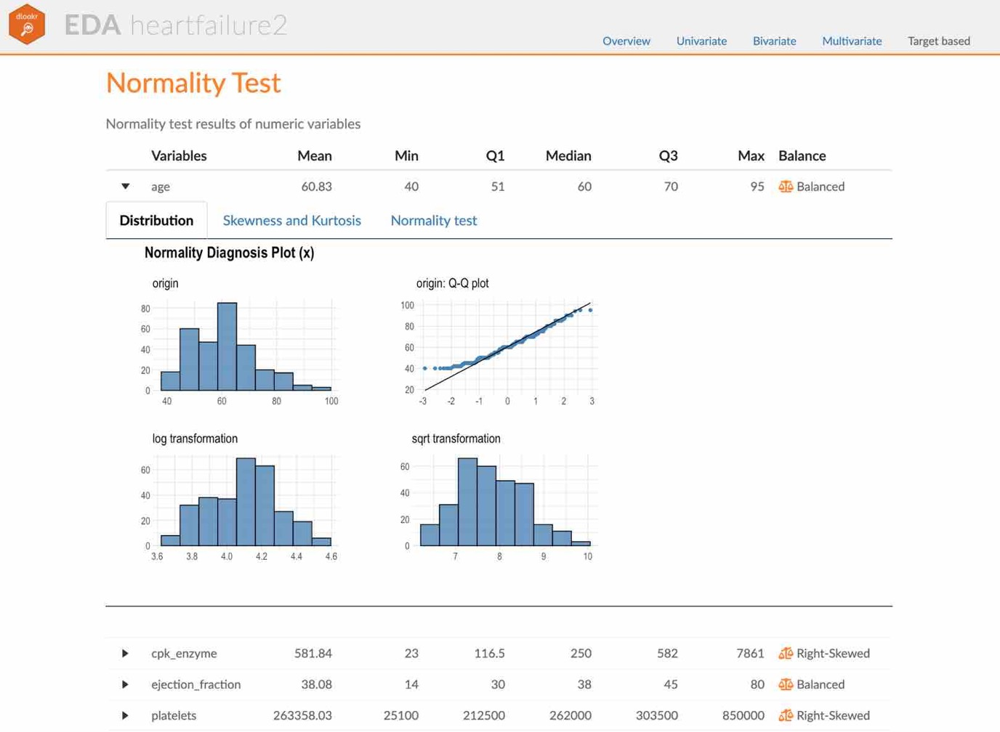
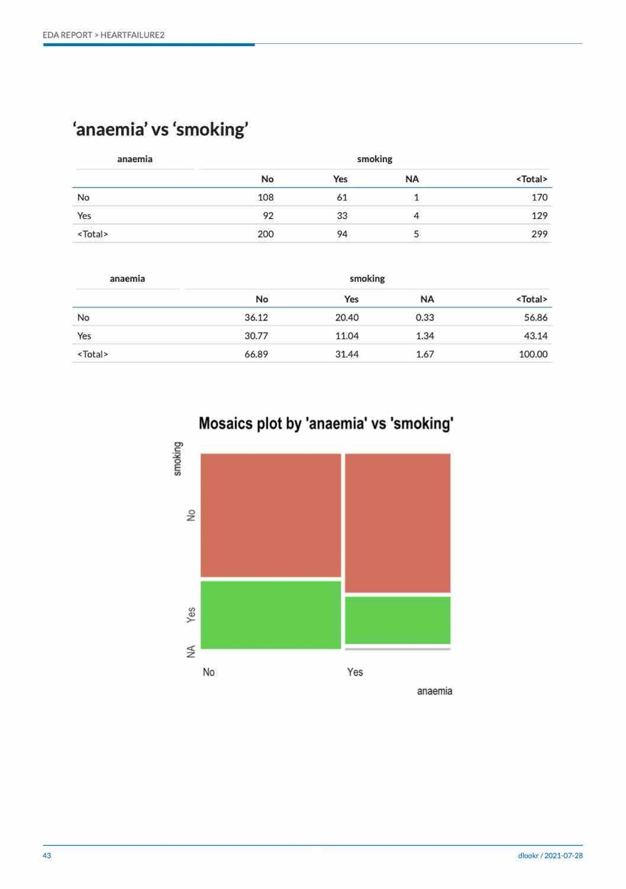
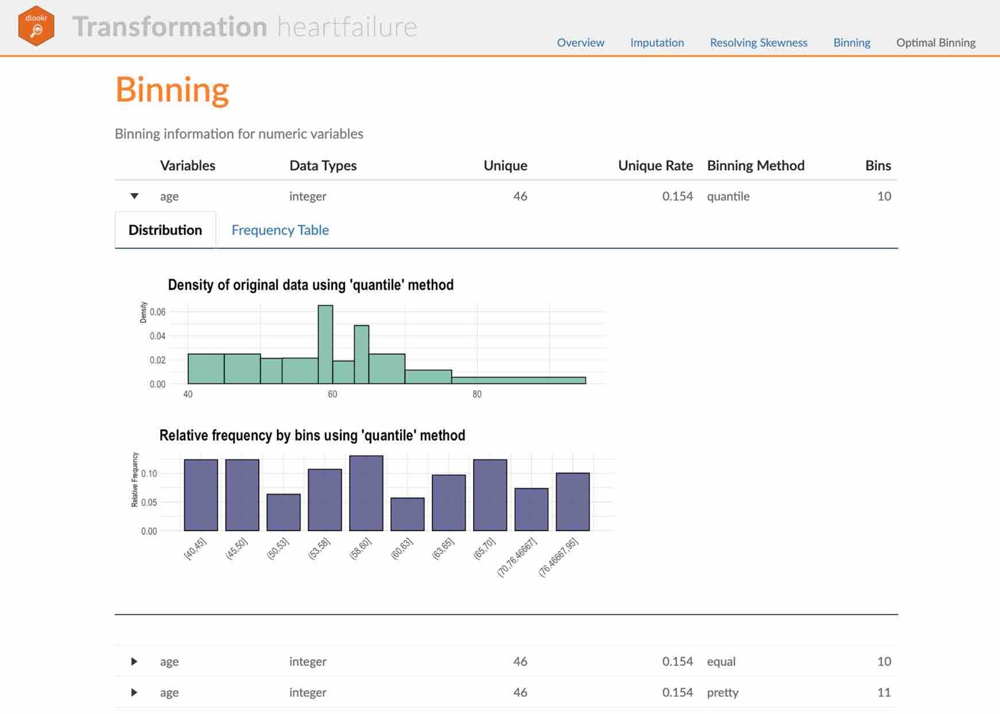
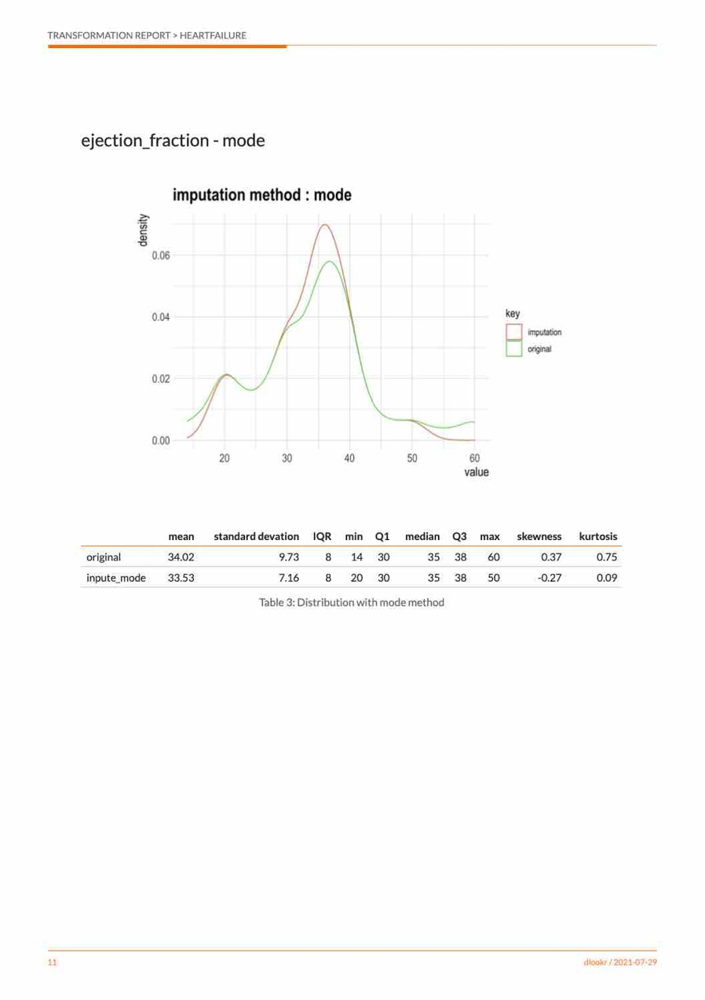

---
output:
  github_document
---

<!-- README.md is generated from README.Rmd. Please edit that file -->

```{r, echo = FALSE}
knitr::opts_chunk$set(
  collapse = TRUE,
  comment = "#>",
  fig.path = "figures/README-"
)
```

# dlookr 

<!-- badges: start -->
[](https://cran.r-project.org/package=dlookr)
[](https://cran.r-project.org/package=dlookr)
<!-- badges: end -->

## Overview

Diagnose, explore, and transform data with `dlookr`.

Features:

  - Diagnose data quality.
  - Find appropriate scenarios to pursue the follow-up analysis through data exploration and understanding.
  - Derive new variables or perform variable transformations.
  - Automatically generate reports for the above three tasks.
  - Supports quality diagnosis and EDA of DBMS tables.
      + version (≥ 0.3.2)    

The name `dlookr` comes from `looking at the data` in the data analysis process.

## Install dlookr

The released version is available on CRAN

```{r eval = FALSE}
install.packages("dlookr")
```

Or you can get the development version without vignettes from GitHub:

```{r eval = FALSE}
devtools::install_github("choonghyunryu/dlookr")
```

Or you can get the development version with vignettes from GitHub:

```{r eval = FALSE}
install.packages(c("DBI", "RSQLite"))
devtools::install_github("choonghyunryu/dlookr", build_vignettes = TRUE)
```

## Usage

dlookr includes several vignette files, which we use throughout the documentation.

The provided vignettes are as follows:

* Data quality diagnosis for data.frame, tbl_df, and DBMS tables
* Exploratory Data Analysis for data.frame, tbl_df, and DBMS tables
* Data Transformation
* Data diagnosis and EDA for DBMS tables

```{r vignettes, eval=FALSE}
browseVignettes(package = "dlookr")
```

### Data quality diagnosis 
#### Data: flights

To illustrate the basic use of the dlookr package, we use the `flights` data in dlookr, which comes from the `nycflights13` package. 
The `flights` data frame contains departure and arrival information on all flights departing from NYC (i.e., JFK, LGA, or EWR) in 2013.

```{r import_data}
library(dlookr)
data(flights)
dim(flights)
flights
```

#### General diagnosis of all variables with `diagnose()`

`diagnose()` allows you to diagnose variables in a data frame. 
Like other `dplyr` functions, the first argument is the tibble (or data frame). 
The second and subsequent arguments refer to variables within the data frame.

The variables of the `tbl_df` object returned by `diagnose()` are as follows.

* `variables` : variable names
* `types` : the data type of the variables
* `missing_count` : number of missing values
* `missing_percent` : percentage of missing values
* `unique_count` : number of unique values
* `unique_rate` : rate of unique values. unique_count / number of observations

For example, we can diagnose all variables in `flights`:

```{r diagnose, warning=FALSE, message=FALSE}
library(dlookr)
library(dplyr)

diagnose(flights)
```

* `Missing Value (NA)` : Variables with many missing values, i.e., those with a `missing_percent` close to 100, should be excluded from the analysis.
* `Unique value` : Variables with a unique value (`unique_count` = 1) should be considered for exclusion from data analysis. 
If the data type is not numeric (integer, numeric) and the number of unique values is equal to the number of observations (unique\_rate = 1), 
then the variable is likely to be an identifier. Therefore, this variable is also not suitable for the analysis model.

`year` can be considered not to be used in the analysis model since `unique_count` is 1. 
However, you do not have to remove it if you configure `date` as a combination of `year`, `month`, and `day`.

For example, we can diagnose only a few selected variables:

```{r diagnoses}
# Select columns by name
diagnose(flights, year, month, day)
# Select all columns between year and day (include)
diagnose(flights, year:day)
# Select all columns except those from year to day (exclude)
diagnose(flights, -(year:day))
```

Using dplyr, variables including missing values can be sorted by the weight of missing values:

```{r diagnose_pipe}
flights %>%
  diagnose() %>%
  select(-unique_count, -unique_rate) %>% 
  filter(missing_count > 0) %>% 
  arrange(desc(missing_count))
```

#### Diagnosis of numeric variables with `diagnose_numeric()`

`diagnose_numeric()` diagnoses numeric (continuous and discrete) variables in a data frame. Usage is the same as `diagnose()` but returns more diagnostic information. However, if you specify a non-numeric variable in the second and subsequent argument list, the variable is automatically ignored.

The variables of the `tbl_df` object returned by `diagnose_numeric()` are as follows.

* `min` : minimum value
* `Q1` : 1/4 quartile, 25th percentile
* `mean` : arithmetic mean
* `median` : median, 50th percentile
* `Q3` : 3/4 quartile, 75th percentile
* `max` : maximum value
* `zero` : number of observations with a value of 0
* `minus` : number of observations with negative numbers
* `outlier` : number of outliers

The summary() function summarizes the distribution of individual variables in the data frame and outputs it to the console. The summary values of numeric variables are `min`, `Q1`, `mean`, `median`, `Q3` and `max`, which help to understand the distribution of data.

However, the result displayed on the console has the disadvantage that the analyst has to inspect it visually. On the other hand, when the summary information is returned in a data frame structure such as tbl_df, the scope of utilization is expanded. `diagnose_numeric()` supports this.

`zero`, `minus`, and `outlier` are useful measures to diagnose data integrity. For example, numerical data in some cases cannot have zero or negative numbers. A numeric variable called `employee salary` cannot have negative numbers or zeros. Therefore, this variable should be checked for the inclusion of zero or negative numbers in the data diagnosis process.

`diagnose_numeric()` can diagnose all numeric variables of `flights` as follows:

```{r diagnose_pipe_numeric}
diagnose_numeric(flights)
```

If a numeric variable cannot logically have a negative or zero value, it can be used with `filter()` to easily find a variable that does not logically match:

```{r diagnose_pipe_numeric_pipe}
diagnose_numeric(flights) %>% 
  filter(minus > 0 | zero > 0) 
```

#### Diagnosis of categorical variables with `diagnose_category()`

`diagnose_category()` diagnoses the categorical (factor, ordered, character) variables of a data frame. The usage is similar to `diagnose()` but returns more diagnostic information. If you specify a non-categorical variable in the second and subsequent argument list, the variable is automatically ignored.

The `top` argument specifies the number of levels to return for each variable. The default is 10, which returns the top 10 levels. Of course, if the number of levels is less than 10, all levels are returned.

The variables of the `tbl_df` object returned by `diagnose_category()` are as follows.

* `variables` : variable names
* `levels`: level names
* `N` : number of observations
* `freq` : number of observations at the levels
* `ratio` : percentage of observations at the levels
* `rank` : rank of occupancy ratio of levels

`diagnose_category()` can diagnose all categorical variables of `flights` as follows:

```{r diagnose_category}
diagnose_category(flights)
```

In collaboration with `filter()` in the `dplyr` package, we can see that the `tailnum` variable is ranked first with 2,512 missing values in the case where the missing value is included in the top 10:

```{r diagnose_category_pipe}
diagnose_category(flights) %>% 
  filter(is.na(levels))
```

The following example returns a list where the level's relative percentage is 0.01% or less. Note that the value of the `top` argument is set to a large value such as 500. If the default value of 10 were used, values below 0.01% would not be included in the list:

```{r diagnose_category_pipe2}
flights %>%
  diagnose_category(top = 500)  %>%
  filter(ratio <= 0.01)
```

In the analytics model, you can also consider removing levels where the relative frequency is very small in the observations or, if possible, combining them together.

#### Diagnosing outliers with `diagnose_outlier()`
`diagnose_outlier()` diagnoses the outliers of the numeric (continuous and discrete) variables of the data frame. The usage is the same as `diagnose()`.

The variables of the `tbl_df` object returned by `diagnose_outlier()` are as follows.

* `outliers_cnt` : number of outliers
* `outliers_ratio` : percent of outliers
* `outliers_mean` : arithmetic average of outliers
* `with_mean` : arithmetic average including outliers
* `without_mean` : arithmetic average excluding outliers

`diagnose_outlier()` can diagnose outliers of all numerical variables on `flights` as follows:

```{r diagnose_outlier}
diagnose_outlier(flights)
```

Numeric variables that contain outliers are easily found with `filter()`:

```{r diagnose_outlier_pipe}
diagnose_outlier(flights) %>% 
  filter(outliers_cnt > 0) 
```

The following example finds a numeric variable with an outlier ratio of 5% or more, and then returns the result of dividing the mean of outliers by the total mean in descending order:

```{r diagnose_outlier_pipe2}
diagnose_outlier(flights) %>% 
  filter(outliers_ratio > 5) %>% 
  mutate(rate = outliers_mean / with_mean) %>% 
  arrange(desc(rate)) %>% 
  select(-outliers_cnt)
```

In cases where the mean of the outliers is large relative to the overall average, it may be desirable to impute or remove the outliers.

#### Visualization of outliers using `plot_outlier()`
`plot_outlier()` visualizes outliers of numerical variables (continuous and discrete) of a data.frame. Usage is the same as `diagnose()`.

The plots derived from the numerical data diagnosis are as follows.

* With outliers box plot
* Without outliers box plot
* With outliers histogram
* Without outliers histogram

The following example uses `diagnose_outlier()`, `plot_outlier()`, and the `dplyr` package to visualize all numerical variables with an outlier ratio of 0.5% or higher.

```{r plot_outlier_pipe, fig.width = 7, fig.height = 4}
flights %>%
  plot_outlier(diagnose_outlier(flights) %>% 
                 filter(outliers_ratio >= 0.5) %>% 
                 select(variables) %>% 
                 unlist())
```

Analysts should look at the results of the visualization to decide whether to remove or replace outliers. In some cases, you should consider removing variables with outliers from the data analysis model.

Looking at the results of the visualization, `arr_delay` shows that the observed values without outliers are similar to the normal distribution. In the case of a linear model, we might consider removing or imputing outliers. `air_time` has a similar shape before and after removing outliers.


### Exploratory Data Analysis
#### Datasets
To illustrate the basic use of EDA in the dlookr package, we use the `Carseats` dataset.
`Carseats` in the `ISLR` package is a simulated data set containing sales of child car seats at 400 different stores. This data is a data.frame created for the purpose of predicting sales volume.

```{r import_data2}
str(Carseats)
```

The contents of individual variables are as follows. (Refer to the ISLR::Carseats man page.)

* Sales
    + Unit sales (in thousands) at each location
* CompPrice
    + Price charged by a competitor at each location
* Income
    + Community income level (in thousands of dollars)
* Advertising
    + Local advertising budget for the company at each location (in thousands of dollars)
* Population
    + Population size in region (in thousands)
* Price
    + Price the company charges for car seats at each site
* ShelveLoc
    + A factor with levels Bad, Good and Medium indicating the quality of the shelving location for the car seats at each site
* Age
    + Average age of the local population
* Education
    + Education level at each location
* Urban
    + A factor with levels No and Yes to indicate whether the store is in an urban or rural location
* US
    + A factor with levels No and Yes to indicate whether the store is in the US or not

When data analysis is performed, data containing missing values is frequently encountered. However, 'Carseats' is complete data without missing values. So the following script creates missing values and saves them as `carseats`.

```{r missing}
carseats <- Carseats

suppressWarnings(RNGversion("3.5.0"))
set.seed(123)
carseats[sample(seq(NROW(carseats)), 20), "Income"] <- NA

suppressWarnings(RNGversion("3.5.0"))
set.seed(456)
carseats[sample(seq(NROW(carseats)), 10), "Urban"] <- NA
```


#### Univariate data EDA
##### Calculating descriptive statistics using `describe()`

`describe()` computes descriptive statistics for numerical data. The descriptive statistics help determine the distribution of numerical variables. Like the functions of dplyr, the first argument is the tibble (or data frame). The second and subsequent arguments refer to variables within that data frame.

The variables of the `tbl_df` object returned by `describe()` are as follows.

* `n` : number of observations excluding missing values
* `na` : number of missing values
* `mean` : arithmetic average
* `sd` : standard deviation
* `se_mean` : standard error of the mean. sd/sqrt(n)
* `IQR` : interquartile range (Q3-Q1)
* `skewness` : skewness
* `kurtosis` : kurtosis
* `p25` : Q1. 25th percentile
* `p50` : median. 50th percentile
* `p75` : Q3. 75th percentile
* `p01`, `p05`, `p10`, `p20`, `p30` : 1%, 5%, 10%, 20%, 30% percentiles
* `p40`, `p60`, `p70`, `p80` : 40%, 60%, 70%, 80% percentiles
* `p90`, `p95`, `p99`, `p100` : 90%, 95%, 99%, 100% percentiles

For example, we can compute the statistics of all numerical variables in `carseats`:

```{r describe}
describe(carseats)
```

* `skewness` : Right-skewed data, that is, variables with large positive skewness, should be considered for log or sqrt transformations to follow the normal distribution. The variable `Advertising` seems to need a variable transformation.
* `mean` and `sd`, `se_mean` : The `Population` with a large `standard error of the mean` (se_mean) has low representativeness of the `arithmetic mean` (mean). The `standard deviation` (sd) is much larger than the arithmetic average.

The results of `describe()` can be sorted by `left or right skewed size` (skewness) using `dplyr`:

```{r describe_pipe}
carseats %>%
  describe() %>%
  select(described_variables, skewness, mean, p25, p50, p75) %>% 
  filter(!is.na(skewness)) %>% 
  arrange(desc(abs(skewness)))
```

The `describe()` function supports the `group_by()` function syntax of the `dplyr` package.

```{r diagnose_pipe2}
carseats %>%
  group_by(US) %>% 
  describe(Sales, Income) 
```

```{r diagnose_pipe3}
carseats %>%
  group_by(US, Urban) %>% 
  describe(Sales, Income) 
```

##### Test of normality on numeric variables using `normality()`
`normality()` performs a normality test on numerical data. The `Shapiro-Wilk normality test` is performed. When the number of observations is greater than 5000, it is tested after extracting 5000 samples by simple random sampling.

The variables of the `tbl_df` object returned by `normality()` are as follows.

* `statistic` : Statistics of the Shapiro-Wilk test
* `p_value` : p-value of the Shapiro-Wilk test
* `sample` : Number of sample observations used in the Shapiro-Wilk test

`normality()` performs the normality test for all numerical variables of `carseats` as follows:

```{r normality}
normality(carseats)
```

You can use `dplyr` to sort variables that do not follow a normal distribution in order of `p_value`:

```{r normality_pipe}
carseats %>%
  normality() %>%
  filter(p_value <= 0.01) %>% 
  arrange(abs(p_value))
```

In particular, the `Advertising` variable is considered to deviate the most from the normal distribution.

The `normality()` function supports the `group_by()` function syntax in the `dplyr` package.

```{r normality_pipe2}
carseats %>%
  group_by(ShelveLoc, US) %>%
  normality(Income) %>% 
  arrange(desc(p_value))
```

The `Income` variable does not follow the normal distribution. However, in the case where `US` is `No` and `ShelveLoc` is `Good` and `Bad` at the significance level of 0.01, it follows the normal distribution.

The following example performs the `normality test of log(Income)` for each combination of `ShelveLoc` and `US` categorical variables to search for variables that follow the normal distribution.

```{r normality_pipe3}
carseats %>%
  mutate(log_income = log(Income)) %>%
  group_by(ShelveLoc, US) %>%
  normality(log_income) %>%
  filter(p_value > 0.01)
```


#### Visualization of normality of numerical variables using `plot_normality()`
`plot_normality()` visualizes the normality of numeric data.

The information that `plot_normality()` visualizes is as follows.

* `Histogram of original data`
* `Q-Q plot of original data`
* `Histogram of log-transformed data`
* `Histogram of square root-transformed data`

In the data analysis process, we often encounter numerical data that follows the `power-law distribution`. Since numerical data that follows the `power-law distribution` can be converted into a normal distribution by performing the `log` or `sqrt` transformation, histograms of the `log` and `sqrt` transformed data are drawn.

`plot_normality()` can also specify several variables like the `normality()` function.

```{r plot_normality, fig.width = 7, fig.height = 4}
# Select columns by name
plot_normality(carseats, Sales, CompPrice)
```

The `plot_normality()` function also supports the `group_by()` function syntax in the `dplyr` package.

```{r plot_normality2, fig.width = 7, fig.height = 4}
carseats %>%
  filter(ShelveLoc == "Good") %>%
  group_by(US) %>%
  plot_normality(Income)
```


#### EDA of bivariate data
##### Calculation of `correlation coefficient` using `correlate()`

`correlate()` calculates the correlation coefficient of all combinations of `carseats` numerical variables as follows:

```{r correlate}
correlate(carseats)
```

The following example calculates the correlation coefficient only for combinations that include several selected variables.

```{r correlate2}
# Select columns by name
correlate(carseats, Sales, CompPrice, Income)
```

`correlate()` produces `two pairs of variables` for each combination (one for each order). So the following example uses `filter()` to get the correlation coefficient for `a pair of variables`:

```{r correlate3}
carseats %>%
  correlate(Sales:Income) %>%
  filter(as.integer(var1) > as.integer(var2))
```

The `correlate()` also supports the `group_by()` function syntax in the `dplyr` package.

```{r correlate4}
carseats %>%
  filter(ShelveLoc == "Good") %>%
  group_by(Urban, US) %>%
  correlate(Sales) %>%
  filter(abs(coef_corr) > 0.5)
```


##### Visualization of the correlation matrix using `plot.correlate()`
`plot.correlate()` visualizes the correlation matrix.

```{r plot_correlate, fig.width = 9, fig.height = 8, out.width='70%'}
carseats %>% 
  correlate() %>%
  plot()
```

`plot.correlate()` can also specify multiple variables, like the `correlate()` function.
The following is a visualization of the correlation matrix including several selected variables.

```{r plot_correlate2, fig.width = 7, fig.height = 4}
# Select columns by name
carseats %>% 
  correlate(Sales, Price) %>%
  plot()
```

The `plot.correlate()` function also supports the `group_by()` function syntax in the `dplyr` package.

```{r plot_correlate3, fig.width = 7, fig.height = 4, warning=FALSE}
carseats %>%
  filter(ShelveLoc == "Good") %>%
  group_by(Urban, US) %>%
  correlate(Sales) %>% 
  plot()
```


#### EDA based on target variable

##### Definition of target variable
To perform EDA based on the `target variable`, you need to create a `target_by` class object.
`target_by()` creates a `target_by` class from an object inheriting from data.frame, or a data.frame. `target_by()` is similar to `group_by()` in `dplyr`, which creates `grouped_df`. The difference is that you specify only one variable.

The following is an example of specifying `US` as the target variable in the `carseats` data.frame:

```{r target_by}
categ <- target_by(carseats, US)
```

##### EDA when the target variable is a categorical variable
Let's perform EDA when the target variable is a categorical variable. When the categorical variable `US` is the target variable, we examine the relationship between the target variable and the predictor.

Cases where predictors are numeric variables:

`relate()` shows the relationship between the target variable and the predictor. The following example shows the relationship between `Sales` and the target variable `US`. The predictor `Sales` is a numeric variable. In this case, the descriptive statistics are shown for each level of the target variable.

```{r target_by2}
# If the variable of interest is a numerical variable
cat_num <- relate(categ, Sales)
cat_num
summary(cat_num)
```

`plot()` visualizes the `relate` class object created by `relate()` as the relationship between the target variable and the predictor variable. The relationship between `US` and `Sales` is visualized by a density plot.

```{r target_by3, fig.width = 7, fig.height = 4, warning=FALSE}
plot(cat_num)
```

Cases where predictors are categorical variables:

The following example shows the relationship between `ShelveLoc` and the target variable `US`. The predictor variable `ShelveLoc` is a categorical variable. In this case, it shows the `contingency table` of two variables. The `summary()` function performs an `independence test` on the contingency table.

```{r target_by4}
# If the variable of interest is a categorical variable
cat_cat <- relate(categ, ShelveLoc)
cat_cat
summary(cat_cat)
```

`plot()` visualizes the relationship between the target variable and the predictor. The relationship between `US` and `ShelveLoc` is represented by a `mosaic plot`.

```{r target_by5, fig.width = 7, fig.height = 4, warning=FALSE}
plot(cat_cat)
```

##### EDA when the target variable is a numerical variable
Let's perform EDA when the target variable is numeric. When the numeric variable `Sales` is the target variable, we examine the relationship between the target variable and the predictor.

```{r target_by6}
# If the variable of interest is a numerical variable
num <- target_by(carseats, Sales)
```

Cases where predictors are numeric variables:

The following example shows the relationship between `Price` and the target variable `Sales`. The predictor variable `Price` is a numeric variable. In this case, it shows the result of a `simple linear model` of the `target ~ predictor` formula. The `summary()` function expresses the details of the model.

```{r target_by7}
# If the variable of interest is a numerical variable
num_num <- relate(num, Price)
num_num
summary(num_num)
```

`plot()` visualizes the relationship between the target and predictor variables. The relationship between `Sales` and `Price` is visualized with a scatter plot. 
The figure on the left shows the scatter plot of `Sales` and `Price` and the regression line with its confidence interval. 
The figure on the right shows the relationship between the original data and the predicted values of the linear model as a scatter plot. If there is a linear relationship between the two variables, the scatter plot of the observations converges on the red diagonal line.

```{r target_by8, fig.width = 7, fig.height = 4, warning=FALSE}
plot(num_num)
```

Cases where predictors are categorical variables:

The following example shows the relationship between `ShelveLoc` and the target variable `Sales`. The predictor `ShelveLoc` is a categorical variable and shows the result of a `one-way ANOVA` of the `target ~ predictor` relationship. The results are expressed in terms of ANOVA.
The `summary()` function shows the `regression coefficients` for each level of the predictor. In other words, it shows detailed information about the `simple regression analysis` of the `target ~ predictor` relationship.

```{r target_by9}
# If the variable of interest is a categorical variable
num_cat <- relate(num, ShelveLoc)
num_cat
summary(num_cat)
```

`plot()` visualizes the relationship between the target variable and the predictor. The relationship between `Sales` and `ShelveLoc` is represented by a `box plot`.

```{r target_by10, fig.width = 7, fig.height = 4, warning=FALSE}
plot(num_cat)
```


### Data Transformation

dlookr imputes missing values and outliers and resolves skewed data. It also provides the ability to bin continuous variables as categorical variables.

Here is a list of the data transformation functions provided by dlookr:

* `find_na()` finds the variables that contain missing values, and `imputate_na()` imputes the missing values.
* `find_outliers()` finds the variables that contain outliers, and `imputate_outlier()` imputes the outliers.
* `summary.imputation()` and `plot.imputation()` provide information and visualization of the imputed variables.
* `find_skewness()` finds the variables of the skewed data, and `transform()` resolves the skewed data.
* `transform()` also performs standardization of numeric variables.
* `summary.transform()` and `plot.transform()` provide information and visualization of transformed variables.
* `binning()` and `binning_by()` convert continuous data into categorical data.
* `print.bins()` and `summary.bins()` show and summarize the binning results.
* `plot.bins()` and `plot.optimal_bins()` provide visualization of the binning result.
* `transformation_report()` performs the data transformation and reports the results.


#### Imputation of missing values
##### Impute missing values with `imputate_na()`

`imputate_na()` imputes the missing values contained in the variable. The predictor with missing values supports both numeric and categorical variables, and supports the following `method`.

* predictor is a numerical variable
    + "mean" : arithmetic mean
    + "median" : median
    + "mode" : mode
    + "knn" : K-nearest neighbors
        + target variable must be specified
    + "rpart" : Recursive Partitioning and Regression Trees
        + target variable must be specified    
    + "mice" : Multivariate Imputation by Chained Equations
        + target variable must be specified  
        + random seed must be set
* predictor is a categorical variable
    + "mode" : mode
    + "rpart" : Recursive Partitioning and Regression Trees
        + target variable must be specified    
    + "mice" : Multivariate Imputation by Chained Equations
        + target variable must be specified  
        + random seed must be set
    
In the following example, `imputate_na()` imputes the missing values of `Income`, a numeric variable of carseats, using the "rpart" method. `summary()` summarizes missing value imputation information, and `plot()` visualizes the imputation information.

```{r imputate_na, fig.width = 7, fig.height = 4}
income <- imputate_na(carseats, Income, US, method = "rpart")

# result of imputation
income

# summary of imputation
summary(income)

# viz of imputation
plot(income)
```

The following example imputes the categorical variable `Urban` using the "mice" method.

```{r imputate_na2, fig.width = 7, fig.height = 4}
library(mice)

urban <- imputate_na(carseats, Urban, US, method = "mice", print_flag = FALSE)

# result of imputation
urban

# summary of imputation
summary(urban)

# viz of imputation
plot(urban)
```
    
##### Collaboration with dplyr
The following example imputes the missing values of the `Income` variable, and then calculates the arithmetic mean for each level of `US`. In this case, `dplyr` is used, and the code is easy to interpret logically using pipes.

```{r imputate_na3}
# The mean before and after the imputation of the Income variable
carseats %>%
  mutate(Income_imp = imputate_na(carseats, Income, US, method = "knn")) %>%
  group_by(US) %>%
  summarise(orig = mean(Income, na.rm = TRUE),
    imputation = mean(Income_imp))
```


#### Imputation of outliers
##### Impute outliers with `imputate_outlier()`

`imputate_outlier()` imputes the outlier values. The predictor with outliers supports only numeric variables and supports the following methods.

* predictor is a numerical variable
    + "mean" : arithmetic mean
    + "median" : median
    + "mode" : mode
    + "capping" : Impute the upper outliers with the 95th percentile, and impute the lower outliers with the 5th percentile.

`imputate_outlier()` imputes the outliers of the numeric variable `Price` using the "capping" method, as follows. `summary()` summarizes outlier imputation information, and `plot()` visualizes imputation information.

```{r imputate_outlier, fig.width = 7, fig.height = 4}
price <- imputate_outlier(carseats, Price, method = "capping")

# result of imputation
price

# summary of imputation
summary(price)

# viz of imputation
plot(price)
```

##### Collaboration with dplyr
The following example imputes the outliers of the `Price` variable, and then calculates the arithmetic mean for each level of `US`. In this case, `dplyr` is used, and the code is easy to interpret logically using pipes.

```{r imputate_outlier2}
# The mean before and after the imputation of the Price variable
carseats %>%
  mutate(Price_imp = imputate_outlier(carseats, Price, method = "capping")) %>%
  group_by(US) %>%
  summarise(orig = mean(Price, na.rm = TRUE),
    imputation = mean(Price_imp, na.rm = TRUE))
```
    

#### Standardization and Resolving Skewness
##### Introduction to the use of `transform()`
`transform()` performs data transformation. Only numeric variables are supported, and the following methods are provided.

* Standardization
    + "zscore" : z-score transformation. (x - mu) / sigma
    + "minmax" : minmax transformation. (x - min) / (max - min)
* Resolving Skewness
    + "log" : log transformation. log(x)
    + "log+1" : log transformation. log(x + 1). Used for values that contain 0.
    + "sqrt" : square root transformation.
    + "1/x" : 1 / x transformation
    + "x^2" : x squared transformation
    + "x^3" : x cubed transformation

##### Standardization with `transform()`
Use the methods "zscore" and "minmax" to perform standardization.

```{r standardization, fig.width = 6, fig.height = 4}
carseats %>% 
  mutate(Income_minmax = transform(carseats$Income, method = "minmax"),
    Sales_minmax = transform(carseats$Sales, method = "minmax")) %>% 
  select(Income_minmax, Sales_minmax) %>% 
  boxplot()
```

##### Resolving Skewed Data with `transform()`
`find_skewness()` searches for variables with skewed data. This function finds data skewed by search conditions and calculates skewness.

```{r resolving1}
# find index of skewed variables
find_skewness(carseats)

# find names of skewed variables
find_skewness(carseats, index = FALSE)

# compute the skewness
find_skewness(carseats, value = TRUE)

# compute the skewness & filtering with threshold
find_skewness(carseats, value = TRUE, thres = 0.1)
```

The skewness of `Advertising` is 0.637. This means that the distribution of data is somewhat skewed to the right. So, to approximate a normal distribution, use `transform()` with the "log" method as follows.
`summary()` summarizes transformation information, and `plot()` visualizes transformation information.

```{r resolving2, fig.width = 7, fig.height = 4}
Advertising_log = transform(carseats$Advertising, method = "log")

# result of transformation
head(Advertising_log)
# summary of transformation
summary(Advertising_log)
# viz of transformation
plot(Advertising_log)
```

It seems that the raw data contains 0, as there is a -Inf in the log-transformed values. So this time, use "log+1".

```{r resolving3, fig.width = 7, fig.height = 4}
Advertising_log <- transform(carseats$Advertising, method = "log+1")

# result of transformation
head(Advertising_log)
# summary of transformation
summary(Advertising_log)
# viz of transformation
plot(Advertising_log)
```

#### Binning
##### Binning of individual variables using `binning()`

`binning()` transforms a numeric variable into a categorical variable by binning it. The following types of binning are supported.

* "quantile" : categorize using quantiles so that each bin has the same frequency
* "equal" : categorize to have equal length segments
* "pretty" : categorize into moderately good segments
* "kmeans" : categorization using K-means clustering
* "bclust" : categorization using bagged clustering technique

Here are some examples of how to bin `Income` using `binning()`:

```{r binning, fig.width = 6, fig.height = 5}
# Binning the carat variable. default type argument is "quantile"
bin <- binning(carseats$Income)
# Print bins class object
bin
# Summarize bins class object
summary(bin)
# Plot bins class object
plot(bin)
# Using labels argument
bin <- binning(carseats$Income, nbins = 4,
              labels = c("LQ1", "UQ1", "LQ3", "UQ3"))
bin
# Using another type argument
binning(carseats$Income, nbins = 5, type = "equal")
binning(carseats$Income, nbins = 5, type = "pretty")
binning(carseats$Income, nbins = 5, type = "kmeans")
binning(carseats$Income, nbins = 5, type = "bclust")

# Extract the binned results
extract(bin)

# -------------------------
# Using pipes & dplyr
# -------------------------
library(dplyr)

carseats %>%
 mutate(Income_bin = binning(carseats$Income) %>% 
                     extract()) %>%
 group_by(ShelveLoc, Income_bin) %>%
 summarise(freq = n()) %>%
 arrange(desc(freq)) %>%
 head(10)
```
    
##### Optimal Binning with `binning_by()`

`binning_by()` transforms a numeric variable into a categorical variable by optimal binning. This method is often used when developing a `scorecard model`.

The following `binning_by()` example optimally bins `Advertising` considering the target variable `US` with a binary class.

```{r binning_by, fig.width = 10, fig.height = 7, dpi=300,out.width='80%'}
# optimal binning using character
bin <- binning_by(carseats, "US", "Advertising")

# optimal binning using name
bin <- binning_by(carseats, US, Advertising)
bin

# summary optimal_bins class
summary(bin)

# performance table
attr(bin, "performance")

# visualize optimal_bins class
plot(bin)

# extract binned results
extract(bin)
```


## Reporting

### Diagnostic Report
dlookr provides two automated data diagnostic reports:

* Web page-based dynamic reports can perform in-depth analysis through visualization and statistical tables.
* Static reports generated as pdf files or html files can be archived as output of data analysis.

#### Create a diagnostic report using `diagnose_web_report()`
`diagnose_web_report()` creates a dynamic report for objects inherited from data.frame (`tbl_df`, `tbl`, etc.) or data.frame.

##### Contents of dynamic web report
The contents of the report are as follows:

* Overview
    + Data Structures
        + Data Structures
        + Data Types
        + Job Information
    + Warnings
    + Variables
* Missing Values
    + List of Missing Values
    + Visualization
* Unique Values
    + Categorical Variables
    + Numerical Variables
* Outliers
* Samples
    + Duplicated
    + Heads
    + Tails

##### Some arguments for dynamic web report
diagnose_web_report() generates various reports with the following arguments.

* output_file
    + name of the generated file.
* output_dir
    + name of the directory in which to generate the report file.
* title
    + title of the report. 
* subtitle
    + subtitle of the report. 
* author
    + author of the report. 
* title_color
    + color of the title.
* thres_uniq_cat
    + threshold to use for "Unique Values - Categorical Variables".
* thres_uniq_num
    + threshold to use for "Unique Values - Numerical Variables".
* logo_img
    + name of the logo image file on the top left.
* create_date
    + The date on which the report is generated.
* theme
    + name of the theme for the report. Supports "orange" and "blue". 
* sample_percent
    + Sample percentage of data for performing the diagnosis.


The following script creates a quality diagnosis report for the `tbl_df` class object, `flights`.

```{r diagnose_web_report, eval=FALSE}
flights %>%
  diagnose_web_report(subtitle = "flights", output_dir = "./", 
                      output_file = "Diagn.html", theme = "blue")
```

##### Screenshot of dynamic report

* Part of the report is shown in the following figure:

```{r diag_web_title, echo=FALSE, out.width='60%', fig.align='center', fig.pos="!h", fig.cap="The part of the report"}

```

* The dynamic contents of the report are shown in the following figure:

```{r diag_web_content, echo=FALSE, out.width='60%', fig.align='center', fig.pos="!h", fig.cap="The dynamic contents of the report"}

```


#### Create a diagnostic report using `diagnose_paged_report()`
`diagnose_paged_report()` creates a static report for objects inherited from data.frame (`tbl_df`, `tbl`, etc.) or data.frame.

#### Contents of static paged report
The contents of the report are as follows:

* Overview
    + Data Structures
    + Job Information
    + Warnings
    + Variables
* Missing Values
    + List of Missing Values
    + Visualization
* Unique Values
    + Categorical Variables
    + Numerical Variables  
* Categorical Variable Diagnosis   
    + Top Ranks
* Numerical Variable Diagnosis
    + Distribution
        + Zero Values
        + Minus Values
    + Outliers
        + List of Outliers
        + Individual Outliers

##### Some arguments for static paged report
diagnose_paged_report() generates various reports with the following arguments.

* output_format
    + report output type. Choose either "pdf" or "html".
* output_file
    + name of the generated file.
* output_dir
    + name of the directory in which to generate the report file.
* title
    + title of the report. 
* subtitle
    + subtitle of the report. 
* abstract_title
    + abstract title of the report.
* author
    + author of the report. 
* title_color
    + color of the title.
* subtitle_color
    + color of the subtitle.
* thres_uniq_cat
    + threshold to use for "Unique Values - Categorical Variables".
* thres_uniq_num
    + threshold to use for "Unique Values - Numerical Variables".
* flag_content_zero	
    + whether to output "Zero Values" information. 
* flag_content_minus	
    + whether to output "Minus Values" information. 
* flag_content_missing	
    + whether to output "Missing Value" information.  
* logo_img
    + name of the logo image file on the top left.
* cover_img
    + name of the cover image file in the center.
* create_date
    + The date on which the report is generated.
* theme
    + name of the theme for the report. Supports "orange" and "blue". 
* sample_percent
    + Sample percentage of data for performing the diagnosis.

The following script creates a quality diagnosis report for the `tbl_df` class object, `flights`.

```{r diagnose_paged_report, eval=FALSE}
flights %>%
  diagnose_paged_report(subtitle = "flights", output_dir = "./",
                        output_file = "Diagn.pdf", theme = "blue")
```

##### Screenshot of static report

* The cover of the report is shown in the following figure:

```{r diag_paged_cover, echo=FALSE, out.width='60%', fig.align='center', fig.pos="!h", fig.cap="The part of the report"}

```

* The contents of the report are shown in the following figure:

```{r diag_paged_cntent, echo=FALSE, out.width='60%', fig.align='center', fig.pos="!h", fig.cap="The dynamic contents of the report"}

```


### EDA Report

dlookr provides two automated EDA reports:

* Web page-based dynamic reports can perform in-depth analysis through visualization and statistical tables.
* Static reports generated as pdf files or html files can be archived as output of data analysis.

#### Create a dynamic report using `eda_web_report()`
`eda_web_report()` creates a dynamic report for objects inherited from data.frame (`tbl_df`, `tbl`, etc.) or data.frame.

##### Contents of dynamic web report
The contents of the report are as follows:

* Overview
    + Data Structures
    + Data Types
    + Job Information
* Univariate Analysis
    + Descriptive Statistics
    + Normality Test
* Bivariate Analysis
    + Compare Numerical Variables
    + Compare Categorical Variables
* Multivariate Analysis
    + Correlation Analysis
        + Correlation Matrix
        + Correlation Plot
* Target-based Analysis
    + Grouped Numerical Variables
    + Grouped Categorical Variables
    + Grouped Correlation

##### Some arguments for dynamic web report
eda_web_report() generates various reports with the following arguments.

* target
    + target variable
* output_file
    + name of the generated file.
* output_dir
    + name of the directory in which to generate the report file.
* title
    + title of the report. 
* subtitle
    + subtitle of the report. 
* author
    + author of the report. 
* title_color
    + color of the title.
* logo_img
    + name of the logo image file on the top left.
* create_date
    + The date on which the report is generated.
* theme
    + name of the theme for the report. Supports "orange" and "blue". 
* sample_percent
    + Sample percentage of data for performing EDA.


The following script creates an EDA report for the `data.frame` class object, `heartfailure`.

```{r eda_web_report, eval=FALSE}
heartfailure %>%
  eda_web_report(target = "death_event", subtitle = "heartfailure", 
                 output_dir = "./", output_file = "EDA.html", theme = "blue")
```

##### Screenshot of dynamic report

* The dynamic contents of the report are shown in the following figure:

```{r eda_web_title, echo=FALSE, out.width='60%', fig.align='center', fig.pos="!h", fig.cap="The part of the report"}

```

#### Create an EDA report using `eda_paged_report()`
`eda_paged_report()` creates a static report for objects inherited from data.frame (`tbl_df`, `tbl`, etc.) or data.frame.

##### Contents of static paged report
The contents of the report are as follows:

* Overview
    + Data Structures
    + Job Information
* Univariate Analysis
    + Descriptive Statistics
        + Numerical Variables
        + Categorical Variables
    + Normality Test    
* Bivariate Analysis
    + Compare Numerical Variables
    + Compare Categorical Variables
* Multivariate Analysis  
    + Correlation Analysis
        + Correlation Coefficient Matrix
        + Correlation Plot
* Target-based Analysis
    + Grouped Numerical Variables
    + Grouped Categorical Variables
    + Grouped Correlation

##### Some arguments for static paged report
eda_paged_report() generates various reports with the following arguments.

* target
    + target variable
* output_format
    + report output type. Choose either "pdf" or "html".
* output_file
    + name of the generated file.
* output_dir
    + name of the directory in which to generate the report file.
* title
    + title of the report. 
* subtitle
    + subtitle of the report. 
* abstract_title
    + abstract title of the report.
* author
    + author of the report. 
* title_color
    + color of the title.
* subtitle_color
    + color of the subtitle.
* logo_img
    + name of the logo image file on the top left.
* cover_img
    + name of the cover image file in the center.
* create_date
    + The date on which the report is generated.
* theme
    + name of the theme for the report. Supports "orange" and "blue". 
* sample_percent
    + Sample percentage of data for performing EDA.

The following script creates an EDA report for the `data.frame` class object, `heartfailure`.

```{r eda_paged_report, eval=FALSE}
heartfailure %>%
  eda_paged_report(target = "death_event", subtitle = "heartfailure", 
                   output_dir = "./", output_file = "EDA.pdf", theme = "blue")
```

##### Screenshot of static report

* The cover of the report is shown in the following figure:

```{r eda_paged_cover, echo=FALSE, out.width='60%', fig.align='center', fig.pos="!h", fig.cap="The part of the report"}

```

* The contents of the report are shown in the following figure:

```{r eda_paged_cntent, echo=FALSE, out.width='60%', fig.align='center', fig.pos="!h", fig.cap="The dynamic contents of the report"}

```


### Data Transformation Report

dlookr provides two automated data transformation reports:

* Web page-based dynamic reports can perform in-depth analysis through visualization and statistical tables.
* Static reports generated as pdf files or html files can be archived as output of data analysis.

#### Create a dynamic report using `transformation_web_report()`
`transformation_web_report()` creates a dynamic report for objects inherited from data.frame (`tbl_df`, `tbl`, etc.) or data.frame.

##### Contents of dynamic web report
The contents of the report are as follows:

* Overview
    + Data Structures
    + Data Types
    + Job Information
* Imputation
    + Missing Values
    + Outliers
* Resolving Skewness
* Binning
* Optimal Binning

##### Some arguments for dynamic web report
transformation_web_report() generates various reports with the following arguments.

* target
    + target variable
* output_file
    + name of the generated file.
* output_dir
    + name of the directory in which to generate the report file.
* title
    + title of the report. 
* subtitle
    + subtitle of the report. 
* author
    + author of the report. 
* title_color
    + color of the title.
* logo_img
    + name of the logo image file on the top left.
* create_date
    + The date on which the report is generated.
* theme
    + name of the theme for the report. Supports "orange" and "blue". 
* sample_percent
    + Sample percentage of data for performing data transformation.


The following script creates a data transformation report for the `tbl_df` class object, `heartfailure`.

```{r trans_web_report, eval=FALSE}
heartfailure %>%
  transformation_web_report(target = "death_event", subtitle = "heartfailure",
                            output_dir = "./", output_file = "transformation.html", 
                            theme = "blue")
```

##### Screenshot of dynamic report

* The dynamic contents of the report are shown in the following figure:

```{r trans_web_title, echo=FALSE, out.width='60%', fig.align='center', fig.pos="!h", fig.cap="The part of the report"}

```

#### Create a static report using `transformation_paged_report()`
`transformation_paged_report()` creates a static report for objects inherited from data.frame (`tbl_df`, `tbl`, etc.) or data.frame.

##### Contents of static paged report
The contents of the report are as follows:

* Overview
    + Data Structures
    + Job Information
* Imputation
    + Missing Values
    + Outliers
* Resolving Skewness
* Binning
* Optimal Binning

##### Some arguments for static paged report
transformation_paged_report() generates various reports with the following arguments.

* target
    + target variable
* output_format
    + report output type. Choose either "pdf" or "html".
* output_file
    + name of the generated file.
* output_dir
    + name of the directory in which to generate the report file.
* title
    + title of the report. 
* subtitle
    + subtitle of the report. 
* abstract_title
    + abstract title of the report.
* author
    + author of the report. 
* title_color
    + color of the title.
* subtitle_color
    + color of the subtitle.
* logo_img
    + name of the logo image file on the top left.
* cover_img
    + name of the cover image file in the center.
* create_date
    + The date on which the report is generated.
* theme
    + name of the theme for the report. Supports "orange" and "blue". 
* sample_percent
    + Sample percentage of data for performing data transformation.

The following script creates a data transformation report for the `data.frame` class object, `heartfailure`.

```{r trans_paged_report, eval=FALSE}
heartfailure %>%
  transformation_paged_report(target = "death_event", subtitle = "heartfailure",
                              output_dir = "./", output_file = "transformation.pdf", 
                              theme = "blue")
```

##### Screenshot of static report

* The cover of the report is shown in the following figure:

```{r trans_paged_cover, echo=FALSE, out.width='60%', fig.align='center', fig.pos="!h", fig.cap="The part of the report"}

```

* The contents of the report are shown in the following figure:

```{r trans_paged_cntent, echo=FALSE, out.width='60%', fig.align='center', fig.pos="!h", fig.cap="The dynamic contents of the report"}

```

## Support for DBMS tables
### Functions that support DBMS tables
The DBMS table diagnostic/EDA functions support in-database mode that performs SQL operations on the DBMS side. If the size of the data is large, using in-database mode is faster.

It is difficult to obtain anomalies or to implement the sampling-based algorithm in the SQL of a DBMS. So some functions do not yet support in-database mode. In this case, the operation is performed in in-memory mode, in which table data is brought to the R side and calculated.
In this case, if the data size is large, the execution speed may be slow. It supports the collect_size argument, which allows you to import the specified number of samples of data into R.

* Functions supporting in-database mode
    + `diagnose()`
    + `diagnose_category()`
* Functions not supporting in-database mode
    + `diagnose_numeric()`
    + `diagnose_outlier()`    
    + `plot_outlier()`  
    + `diagnose_web_report()`
    + `diagnose_paged_report()`    
    + `normality()`
    + `plot_normality()`    
    + `correlate()`  
    + `plot.correlate()`
    + `describe()`
    + `eda_web_report()`
    + `eda_paged_report()`    
  
#### How to use functions

* Function calls using in-database mode
    + in_database = TRUE
* Function calls using in-memory mode
    + in_database = FALSE 
* Diagnosis and EDA using sample data from DBMS
    + collect_size = <sample size>
    + in-memory mode only
    
### Preparing table data
Copy the `carseats` data frame to the SQLite DBMS and create it as a table named `TB_CARSEATS`.
MySQL/MariaDB, PostgreSQL, Oracle DBMS, etc. are also available, depending on your environment. 

```{r dbi_table, warning=FALSE, message=FALSE}
if (!require(DBI)) install.packages('DBI')
if (!require(RSQLite)) install.packages('RSQLite')
if (!require(dplyr)) install.packages('dplyr')
if (!require(dbplyr)) install.packages('dbplyr')

library(dbplyr)
library(dplyr)

carseats <- Carseats
carseats[sample(seq(NROW(carseats)), 20), "Income"] <- NA
carseats[sample(seq(NROW(carseats)), 5), "Urban"] <- NA

# connect DBMS
con_sqlite <- DBI::dbConnect(RSQLite::SQLite(), ":memory:")

# copy carseats to the DBMS with a table named TB_CARSEATS
copy_to(con_sqlite, carseats, name = "TB_CARSEATS", overwrite = TRUE)
```

### Diagnose tables in the DBMS
#### Diagnose data quality of variables in the DBMS
Use `dplyr::tbl()` to create a tbl_dbi object, then use it as a data frame object. That is, the data argument of all diagnose functions is specified as a tbl_dbi object instead of a data frame object.

```{r dbi_diag}
# Diagnosis of all columns
con_sqlite %>% 
  tbl("TB_CARSEATS") %>% 
  diagnose()

# Positions values select columns, and In-memory mode
con_sqlite %>% 
  tbl("TB_CARSEATS") %>% 
  diagnose(1, 3, 8, in_database = FALSE)
```

#### Diagnose data quality of categorical variables in the DBMS
```{r dbi_category}
# Positions values select variables, and In-memory mode and collect size is 200
con_sqlite %>% 
  tbl("TB_CARSEATS") %>% 
  diagnose_category(7, in_database = FALSE, collect_size = 200) 
```

#### Diagnose data quality of numerical variables in the DBMS
```{r dbi_numeric}
# Diagnosis of all numerical variables
con_sqlite %>% 
  tbl("TB_CARSEATS") %>% 
  diagnose_numeric()
```

#### Diagnose outliers of numerical variables in the DBMS
```{r dbi_outlier}
con_sqlite %>% 
  tbl("TB_CARSEATS") %>% 
  diagnose_outlier()  %>%
  filter(outliers_ratio > 1)
```

#### Plot outlier information of numerical data diagnosis in the DBMS
```{r plot_outlier_dbi, fig.width = 7, fig.height = 4}
# Visualization of numerical variables with a ratio of
# outliers greater than 1%
con_sqlite %>% 
  tbl("TB_CARSEATS") %>% 
  plot_outlier(con_sqlite %>% 
                 tbl("TB_CARSEATS") %>% 
                 diagnose_outlier() %>%
                 filter(outliers_ratio > 1) %>%
                 select(variables) %>%
                 pull())
```

#### Reporting the information of data diagnosis for a DBMS table
The following shows several examples of creating a data diagnosis report for a DBMS table.

Using the `collect_size` argument, you can perform data diagnosis with the corresponding number of sample data.
If the amount of data is very large, use `collect_size`.

```{r dbi_diag_report, eval=FALSE}
# create html file. 
con_sqlite %>% 
  tbl("TB_CARSEATS") %>% 
  diagnose_web_report()

# create pdf file. file name is Diagn.pdf
con_sqlite %>% 
  tbl("TB_CARSEATS") %>% 
  diagnose_paged_report(output_format = "pdf", output_file = "Diagn.pdf")
```

### EDA of tables in the DBMS
#### Calculating descriptive statistics of numerical columns of a table in the DBMS
Use `dplyr::tbl()` to create a tbl_dbi object, then use it as a data frame object. That is, the data argument of all EDA functions is specified as a tbl_dbi object instead of a data frame object.

```{r dbi_describe}
# extract only those with 'Urban' variable level is "Yes",
# and find 'Sales' statistics by 'ShelveLoc' and 'US'
con_sqlite %>% 
  tbl("TB_CARSEATS") %>% 
  filter(Urban == "Yes") %>%
  group_by(ShelveLoc, US) %>%
  describe(Sales)
```

#### Test of normality on numeric columns in the DBMS
```{r dbi_normality}
# Test log(Income) variables by 'ShelveLoc' and 'US',
# and extract only p.value greater than 0.01.

# SQLite extension functions for log transformation
RSQLite::initExtension(con_sqlite)

con_sqlite %>% 
  tbl("TB_CARSEATS") %>% 
 mutate(log_income = log(Income)) %>%
 group_by(ShelveLoc, US) %>%
 normality(log_income) %>%
 filter(p_value > 0.01)
```

#### Normality visualization of numerical columns in the DBMS
```{r plot_normality_dbi, fig.width = 7, fig.height = 4}
# extract only those with 'ShelveLoc' variable level is "Good",
# and plot 'Income' by 'US'
con_sqlite %>% 
  tbl("TB_CARSEATS") %>% 
  filter(ShelveLoc == "Good") %>%
  group_by(US) %>%
  plot_normality(Income)
```

#### Compute the correlation coefficient between two columns of the table in the DBMS
```{r dbi_correlation}
# extract only those with 'ShelveLoc' variable level is "Good",
# and compute the correlation coefficient of 'Sales' variable
# by 'Urban' and 'US' variables.
# And the correlation coefficient is negative and smaller than 0.5
con_sqlite %>% 
  tbl("TB_CARSEATS") %>% 
  filter(ShelveLoc == "Good") %>%
  group_by(Urban, US) %>%
  correlate(Sales) %>%
  filter(coef_corr < 0) %>%
  filter(abs(coef_corr) > 0.5)
```

#### Visualize the correlation plot of numerical columns in the DBMS
```{r plot_correlation_dbi, fig.width = 7, fig.height = 4, warning=FALSE}
# Extract only those with 'ShelveLoc' variable level is "Good",
# and visualize correlation plot of 'Sales' variable by 'Urban'
# and 'US' variables.
con_sqlite %>% 
  tbl("TB_CARSEATS") %>% 
  filter(ShelveLoc == "Good") %>%
  group_by(Urban, US) %>%
  correlate(Sales) %>% 
  plot()
```

#### EDA based on target variable
The following is an EDA where the target column is of character type and the predictor column is of numeric type.

```{r dbi_ctarget_by}
# If the target variable is a categorical variable
categ <- target_by(con_sqlite %>% tbl("TB_CARSEATS") , US)

# If the variable of interest is a numarical variable
cat_num <- relate(categ, Sales)
cat_num
summary(cat_num)
```

```{r plot_target_by_dbi, fig.width = 7, fig.height = 4}
plot(cat_num)
```

#### Reporting the information of EDA for a DBMS table
The following shows several examples of creating an EDA report for a DBMS table.

Using the `collect_size` argument, you can perform EDA with the corresponding number of sample data.
If the amount of data is very large, use `collect_size`.

```{r dbi_diag_report2, eval=FALSE}
# create html file. file name is EDA_TB_CARSEATS.html
con_sqlite %>% 
  tbl("TB_CARSEATS") %>% 
  eda_web_report(US, output_file = "EDA_TB_CARSEATS.html")

## target variable is numerical variable
# reporting the EDA information, and collect size is 350
con_sqlite %>% 
  tbl("TB_CARSEATS") %>% 
  eda_web_report(Sales, collect_size = 350)

# create pdf file. file name is EDA2.pdf
con_sqlite %>% 
  tbl("TB_CARSEATS") %>% 
  eda_paged_report("Sales", output_file = "EDA2.pdf")
```


